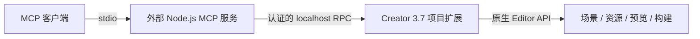

# Cocos Creator 3.7 MCP

[English](README.en.md) · [操作说明](docs/OPERATIONS.md) · [与 3.8 参考项目对照](docs/COMPARISON.md) · [稳定性与测试](docs/STABILITY.md)

让支持 MCP 的 AI 客户端通过 **Cocos Creator 原生编辑器接口**操作 3.7 工程：查询场景、编辑节点和组件、设置属性与引用、管理资源和预制体，以及调用预览和构建。

本项目面向仍在维护 Creator 3.7 项目的开发者。外部 Node.js 运行 MCP 服务，Creator 内运行一个轻量项目扩展，避免将现代 MCP SDK 放入编辑器自带的旧 Node.js 环境。当前实现 **17 个 MCP 工具、36 条桥接命令**；实际提供的工具和 action 按当前编辑器能力收缩。

**当前为 0.1.0，处于实验性公开测试阶段。** 已有 Windows x64 的 Creator **3.7.0–3.7.4** 分版本实测，包含 **3.7.1、3.7.2**；完整 Web 构建成功证据仅限本机 3.7.3 的 `web-desktop`、`debug:true` 场景。尚未完成长期运行、跨系统编辑器和全部构建平台验收。适合先在有版本控制的工程副本中评估，尚不宣称生产稳定版。具体范围见[验收矩阵](docs/STABILITY.md)。

## 快速开始

### 1. 准备环境

- Cocos Creator **3.7.x** 和一个已经能正常打开的工程。
- 外部 Node.js **20+** 和 npm；日常使用建议 Node.js **22 或 24 LTS**，维护状态见 [Node.js 官方发布表](https://github.com/nodejs/Release)。
- 一个支持 **stdio MCP** 的客户端。

克隆仓库，安装依赖并复制项目扩展：

```powershell
git clone https://github.com/patrickleehua/cocos-creator-mcp.git
cd cocos-creator-mcp
npm ci
node scripts/install-extension.mjs "D:/projects/MyGame"
```

安装前关闭目标工程的 Creator。脚本将扩展安装到 `<工程>/extensions/cocos-creator-mcp`，不改动编辑器安装目录。打开工程，在 Creator 扩展管理器启用该**项目扩展**，随后重启 Creator，打开场景并等待资源导入完成。

控制台出现 `[cocos-creator-mcp] Bridge ready ...` 表示桥接已启动。扩展菜单 **Cocos MCP** 提供 **Start bridge / Stop bridge / Show status**。

已有本扩展时，更新使用：

```powershell
node scripts/install-extension.mjs "D:/projects/MyGame" --update
```

更新后同样重启 Creator。安装与更新的保护和恢复边界见[稳定性说明](docs/STABILITY.md#安装与更新)。

### 2. 配置 MCP 客户端

将服务脚本和工程路径替换为本机**绝对路径**。以下是支持 `mcpServers` 配置的客户端通用示例，具体配置位置以客户端文档为准：

```json
{
  "mcpServers": {
    "cocos-creator-37": {
      "command": "node",
      "args": [
        "D:/tools/cocos-creator-mcp/src/server.mjs",
        "--project",
        "D:/projects/MyGame"
      ]
    }
  }
}
```

客户端若找不到 `node`，将 `command` 改成 Node.js 可执行文件的绝对路径。一个服务进程绑定一个工程；Creator 必须打开同一个工程。MCP 客户端负责启动和管理服务进程。

先让客户端调用 `editor_info` 和 `scene_query`，核对工程、版本、当前场景和 `dirty` 状态，再开始修改。例如：

> 查询当前场景，在 Canvas 下创建一个名为 Greeting 的节点，添加 Label，设置文本为“你好，Cocos 3.7”。读回确认后保存场景。

也可以手动启动服务以检查配置；stdio 服务正常启动后会等待 MCP 输入，并不显示交互提示符：

```powershell
node src/server.mjs --project "D:/projects/MyGame" --timeout 45000
```

`--timeout` 单位为毫秒，默认 15000。它限制一次桥接请求的等待时间，不代表后台构建时限。

### Windows 会额外弹出命令行窗口吗？

正常连接时由 MCP 客户端直接启动 `node`，本项目不会为场景操作另开测试编辑器或命令行。手动在终端执行服务时，该终端需要保留。避免用 `cmd /c start` 等包装启动服务。

本项目的 Node 测试子进程已使用 `windowsHide:true`。原生编辑器验收曾因额外的 `--enable-logging` 调试启动及遗留子进程出现黑色控制台；后续测试移除该开关并清理自身进程。测试启动时重定向 stdout/stderr 到文件，避免额外启用 stderr 调试输出。Electron 的 Windows 子进程日志限制见[官方说明](https://www.electronjs.org/docs/latest/api/command-line-switches#--enable-loggingfile)。原生构建工具是否弹窗还取决于 Creator / 平台工具链，不承诺能控制其全部子进程。

## 可以做什么

| 工具 | 操作 | 说明 |
| --- | --- | --- |
| `editor_info` | 查询 | 版本、工程身份、当前能力。 |
| `scene_query` | 查询 | 场景就绪状态、未保存状态、节点树。 |
| `scene_open` | 打开 | 按场景资源 UUID 或 `db://` URL 打开。 |
| `scene_save` | 保存 | 调用原生保存并核对 dirty 状态。 |
| `scene_create` | 创建 | 使用当前安装的原生 2D 场景模板。 |
| `scene_history` | `undo` / `redo` | 原生历史记录，复合操作不保证单步回滚。 |
| `node_query` | 查询 | 按 UUID、层级路径或名称查找。 |
| `node_edit` | `create` / `remove` / `reparent` / `duplicate` | 创建、删除、换父节点、复制。 |
| `component_edit` | `catalog` / `list` / `add` / `remove` | 查询已注册组件，按组件实例操作。 |
| `property_set` | 设置 | 按原生类型写入并读回；包含 Node、Component、Asset、数组和事件引用的已测路径。 |
| `asset_query` | `search` / `info` / `meta` / `uuid` / `url` / `path` | 搜索、身份及导入信息查询。 |
| `asset_edit` | `create` / `save` / `import` / `move` / `copy` / `delete` / `meta` | 资源文件操作、导入设置合并与重新导入。 |
| `prefab_manage` | `create` / `instantiate` | 原生创建和实例化，返回转换后的身份映射。 |
| `ui_build` | 创建子树 | 按描述创建节点、组件和属性；可能部分完成。 |
| `editor_preview` | `info` / `open` / `refresh` | 原生预览 URL、启动和刷新。 |
| `editor_logs` | 查询 | 已识别原生日志支持级别、数量、毫秒时间戳过滤。 |
| `project_build` | `config` / `start` / `status` / `cancel` | 异步构建、状态查询与归属校验后的取消。 |

完整输入以客户端收到的 schema 为准。参数与返回语义、SpriteFrame 导入、固定 Label 尺寸、后台构建及错误恢复见[操作说明](docs/OPERATIONS.md)。

## 为什么需要单独适配 3.7

参考的 [cocos-mcp-server](https://github.com/DaxianLee/cocos-mcp-server) 本地源码版本为 **1.5.4**，声明支持 **Creator ≥3.8.6**。本项目保留“通过编辑器扩展连接 AI 与原生编辑操作”的思路，按 3.7 的安装包和真实运行行为实现适配。

这涉及运行环境和接口契约：3.7 内置 Node.js 14；节点创建需要显式补加组件并检查；删除组件使用组件实例 UUID；资源修改先解析原生 URL；属性写入需要保留数组、引用、事件等类型信息；Prefab 转换可能替换节点和组件身份。3.8 的事务分组消息也不能直接用于已检查的 3.7 安装。

参考仓库 README 同时介绍开源版与 Pro 版，因此按源码中的工具入口和 action 对照，不用宣传数量计算覆盖率。

| 方向 | 当前状态 |
| --- | --- |
| 场景、节点、组件、资源、基础 Prefab、预览和构建 | 已提供对应工具，按[验收范围](docs/STABILITY.md)验证。 |
| 复杂属性和引用 | 有自定义脚本、Node / Component / Asset、数组、Button 事件和保存重开的实测。 |
| 高级 Prefab、剪贴板、属性重置、场景视图、参考图、偏好和依赖分析 | 仍有缺口，逐项见[完整对照](docs/COMPARISON.md)；部分可通过通用接口组合，不等于完整专用工作流。 |
| 3.8 新接口和批量事务 | 按实际可用性适配；3.7 复合写入不承诺原子性。 |
| 任意脚本执行 / 远程 HTTP MCP | 未提供。当前为 stdio MCP + 本机内部 RPC。 |

对照基准、功能映射、版本差异和优先级见 [COMPARISON.md](docs/COMPARISON.md)。

## 稳定性设计与使用边界



- **按工程连接。** 校验真实工程路径、UUID 和会话身份；扩展重启后刷新能力清单。
- **限定本机访问。** bridge 监听 `127.0.0.1` 的随机端口，要求 Bearer 认证，校验 Host，拒绝带 Origin 的请求。
- **限定执行范围。** 命令白名单、严格输入 schema、按原生消息清单开放能力；清单无效时关闭对应能力。
- **核验修改结果。** 对支持的写入读回属性、结构、UUID 或资源内容；保护未保存场景，串行调度 RPC。
- **谨慎处理失败。** 不自动重放写入；超时可能是结果未知，先查询实际状态。复合操作可部分完成，需要按返回信息恢复。
- **保护构建归属。** 检查已有原生任务，只取消可确认属于本扩展的任务；取消受理后仍等待原生终态。

不要在同一个工程中同时让人和多个自动化客户端修改场景或启动构建。同一进程存在多个场景窗口时，相关操作会拒绝执行。`requested:true`、构建 taskId 或单次读回成功均不等于整个游戏工作流已经验收。

`<工程>/temp/cocos-creator-mcp/session.json` 包含会话凭据，请勿提交或贴入 issue。更多边界见 [SECURITY.md](SECURITY.md)。

## 测试、贡献与开源准备

```powershell
npm ci
npm test
```

当前本地单元与契约测试 **420/420 通过**，单元测试不需要安装 Creator。已配置 GitHub Actions 的 Windows / Ubuntu、Node.js 20 / 22 / 24 检查；只有工作流在托管平台实际运行后才有 CI 通过结论。真实编辑器集成需要专用测试工程，不以模拟 Editor 的测试替代。

- [稳定性矩阵与发布条件](docs/STABILITY.md)：当前证据、未覆盖场景、复测要求。
- [贡献指南](CONTRIBUTING.md)：开发、真实集成测试、提交问题与改动要求。
- [安全说明](SECURITY.md)：凭据、访问边界和漏洞反馈。
- [3.7 调查记录](docs/creator-3.7-investigation.md)：安装包、接口差异和历史验证过程。
- [验证证据清单](analysis/validation/manifest.json)：带版本与源码哈希的运行报告。

欢迎先补充可复现的兼容性案例、失败恢复和长期运行测试，再扩充专用编辑功能。[参考项目对照](docs/COMPARISON.md)给出了后续方向。

**许可证：** 本项目原创代码与文档采用 [MIT](LICENSE)，署名为项目贡献者。第三方代码保留各自条款，见 [NOTICE.md](NOTICE.md)。参考仓库没有独立 LICENSE，且 README 载有商用及衍生代码限制，本项目 MIT 不覆盖其授权。发布前按[发布条件](docs/STABILITY.md#发布条件)完成来源检查与验收。
