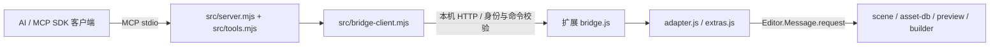

# Cocos Creator 3.7 调查与实现验证记录

历史记录日期：2026-10-16。当前验收与后续修订见 [稳定性说明](STABILITY.md)。参考源码固定提交见 [COMPARISON.md](COMPARISON.md)。

截至该历史记录，产品已实现独立 MCP 服务和 Creator 3.7 薄扩展，包含 **17 个 MCP 工具、36 个桥接命令**。官方 **3.7.0、3.7.1、3.7.2、3.7.4** 与本机带 backport 的 **3.7.3** 均已实际运行：五版本各自核心 **13/13**、复杂引用 **7/7** 通过。extras 在 3.7.0／3.7.4 各 **3/3**，在 3.7.1／3.7.2／3.7.3 各 **4/4**，包含真实构建取消。3.7.1、3.7.2 另通过 SDK 预览启动及独立 Chrome 实时预览验证；3.7.3 完整 Web 构建及产物运行仍为独立记录。

本文区分三类证据：安装包与 REA 的原始静态证据、当前源码实现、已有真实运行报告。静态注册、源码存在、模拟 Editor 的测试以及真机通过，不能互相替代。

## 证据来源与适用范围

| 证据 | 可确认的内容 | 不能据此确认的内容 |
| --- | --- | --- |
| [ASAR 对照报告](../analysis/creator-3.7.3-vs-3.8.7.json) | 两个指定安装包的身份、哈希、消息注册与声明差异 | 消息实际签名、操作效果、某 API 首次出现的版本 |
| 本地原始 REA 结果（不分发）及[摘要](../analysis/rea-creator-3.7.3-summary.json) | 摘录文件的静态分析及覆盖边界 | 编辑器实际执行路径和修改是否持久化 |
| [产品源码](../src/server.mjs)、[适配器](../extensions/cocos-creator-mcp/adapter.js)及 [tests](../tests/) | 当前协议、适配逻辑、输入与失败分支的测试设计 | 所有 Editor 原生实现均符合模拟测试 |
| 官方包下载记录：[3.7.0／3.7.4](../analysis/versions-download.json)、[3.7.1](../analysis/versions-download-3.7.1.json)、[3.7.2](../analysis/versions-download-3.7.2.json) | 官方来源、完整包 SHA-256、全部 ZIP 成员 CRC 及解包校验 | 运行兼容性；下载阶段的未执行字段不描述后续测试状态 |
| [验证归档目录](../analysis/validation/)及[证据清单](../analysis/validation/manifest.json) | 按版本保存的核心、复杂引用、extras、构建和浏览器结果；源码与 ASAR 哈希由 manifest 绑定 | 未执行版本、未覆盖场景及任意长期稳定性保证 |

原始静态调查对象如下；后续真机结论也必须保留本机安装带补丁这一限制。

| 对象 | 原始静态身份 |
| --- | --- |
| 开源参考项目 | package 1.5.4，`editor >=3.8.6`，Creator 类型依赖 `^3.8.6` |
| 本机 Creator 3.7.3 | `C:\ProgramData\cocos\editors\Creator\3.7.3\resources\app.asar`，714,952,502 字节，96,557 个文件条目 |
| 对照 Creator 3.8.7 | 同一安装根下的 `3.8.7\resources\app.asar`，764,495,802 字节，73,429 个文件条目 |
| 本机补丁 | 3.7.3 的 `resources/repack.json` 标记 builder-ui、engine、global-builtin-hot-update 等 backport 模块；该安装不能等同于未经修改的官方发行包 |

原始 REA 分析的 Evidence ID 为 `ev_5c4ad5abd8b0f147022e7f7e430943db356d5c131e6e7557df75f4c60237f0bb`。摘要统计为 22 个相关文件、13 个已解析 JavaScript/TypeScript 文件及 1 个解析失败，application 覆盖为 partial，semantic 状态为 unknown。摘录目录 SHA-256 为 `d718e6393ae21ef68acb39ccd94594a32b1558735bc688199a62c5f2605ab18a`，不是整个 ASAR 的哈希；完整 ASAR 与所读成员哈希见对照报告。`.ccc` 实现未解密或反编译。

后续独立验证使用的 3.7.0／3.7.4 Windows 包来自官方目录和下载域名，完整下载的本地 SHA-256 分别为 `67e25e2ba714b55af037f444c047699eb87cf708f27864b31799a5a5f145e827`、`1620923fffff704ee1cf166314adb572b3ea939c36bc85a41adf872d68ebd9b7`，解压记录的 `allExtractedMemberCrcsVerified` 均为 true。官方目录未提供 checksum 字段，因此这两个 SHA-256 是完整下载的本地身份记录，不应写成已与官方公布摘要比对。

“调查时未启动编辑器、尚未做端到端验证”只描述原始静态阶段。当前已有下述真实运行报告，不能继续把产品描述成仅有探针；也不能把后续运行结果倒写成 REA 已证明的事实。

## 已实现的架构

实际模块位于 `src/` 和 `extensions/cocos-creator-mcp/`，并非尚待创建的 `packages/` 方案。

- **外部现代 Node 承载 MCP。** 根 [package.json](../package.json) 要求 Node `>=20`，锁定 `@modelcontextprotocol/sdk` 1.32.1 和 Zod 3.25.76。[server.mjs](../src/server.mjs) 使用 SDK 的 `StdioServerTransport`；[tools.mjs](../src/tools.mjs) 负责工具目录、Schema、能力刷新及 `isError:true` 的结构化错误。
- **编辑器内保留 Node 14 薄桥。** 五个已测版本的运行报告均读取到 Node **14.16.0**、Electron **13.1.4**。扩展使用 CommonJS 和 Node 内置模块，不把现代 MCP SDK 装入编辑器进程。扩展的 `editor >=3.7.0 <3.8.0` 及启动版本检查是适配目标范围；实际通过范围仍限定为下表中的五个安装版本。
- **桥接 HTTP 是内部 RPC。** [bridge.js](../extensions/cocos-creator-mcp/bridge.js) 在 `127.0.0.1` 分配端口，把 token、sessionId、工程身份等写入工程的 `temp/cocos-creator-mcp/session.json`，提供鉴权的 `/health` 和 `/rpc`。桥接协议的 `protocolVersion:1` 与 MCP 的版本协商不是同一协议；当前对客户端的 MCP 传输为 stdio。
- **连接按工程和会话确认。** [bridge-client.mjs](../src/bridge-client.mjs) 读取发现文件，校验 health 的工程路径、UUID、编辑器版本及 session，并在 RPC 前再次检查发现文件。固定命令白名单与会话能力共同决定可调用项，工具 action 也随实际能力过滤。
- **修改串行，失败不伪装成功。** 桥接队列和请求去重避免重复派发；客户端断开不会让仍在运行的 Editor 操作提前让出队列。写请求超时或失去响应可标记 `outcome:unknown`、`retryable:false`，不自动重放。已确认的原生结果由适配器读回核验，部分完成通过错误 details 暴露。
- **核心写操作走原生消息。** [adapter.js](../extensions/cocos-creator-mcp/adapter.js) 处理 scene/asset-db，场景创建读取当前安装自带的 `scene-2d` 模板；Prefab 交给原生 `create-prefab` 序列化。[scene.js](../extensions/cocos-creator-mcp/scene.js) 目前仅保留预定义的 summary 辅助方法，不能描述成核心写操作依赖任意脚本执行。

能力注册仍不等于运行验收：当前核心适配器读取模块消息清单，清单缺失、损坏或 methods 无效时关闭对应能力；extras 按其消息/API 条件注册。早期实现曾在清单读取失败时尝试注册，此行为已修复并补回归测试。最终以会话能力与实际调用结果为准。

## 当前工具目录与数量口径

以下是 [tools.mjs](../src/tools.mjs) 和 [COMMANDS 白名单](../src/bridge-client.mjs) 的实现全集，不表示每个 Editor 会话必然开放全部命令。

| MCP 工具 | 桥接命令 |
| --- | --- |
| `editor_info` | `editor.info` |
| `scene_query` | `scene.query` |
| `scene_open` | `scene.open` |
| `scene_save` | `scene.save` |
| `scene_create` | `scene.create` |
| `scene_history` | `scene.undo`、`scene.redo` |
| `node_query` | `node.query` |
| `node_edit` | `node.create`、`node.remove`、`node.reparent`、`node.duplicate` |
| `component_edit` | `component.catalog`、`component.list`、`component.add`、`component.remove` |
| `property_set` | `property.set` |
| `asset_query` | `asset.query`（search/info/meta/uuid/url/path） |
| `asset_edit` | `asset.create`、`asset.save`、`asset.import`、`asset.move`、`asset.copy`、`asset.delete`、`asset.meta` |
| `prefab_manage` | `prefab.create`、`prefab.instantiate` |
| `ui_build` | `ui.build` |
| `editor_preview` | `preview.info`、`preview.open`、`preview.refresh` |
| `editor_logs` | `editor.logs` |
| `project_build` | `build.config`、`build.start`、`build.status`、`build.cancel` |

五个版本的最新核心与复杂引用报告均声明 36 个桥接命令。旧的单次 `integration-report.json` 已被分版本报告替代，不再用其较早的命令数描述产品。工具发现与命令数量仍不等于每一种参数组合都已穷尽验收；实际覆盖见下文。

## 3.7.3 运行期发现与已落实的适配

以下 gotchas 最初来自本机带 backport 的 3.7.3；相应规则已落实到 [adapter.js](../extensions/cocos-creator-mcp/adapter.js)，共同适配路径现已通过官方 3.7.0、官方 3.7.4 和本机 3.7.3 的核心及复杂引用验证。[原生契约测试](../tests/adapter-native-contract.test.cjs) 仍是模拟 Editor 的补充证据，不另算真机通过数。

| 问题 | 实际观察及实现处理 | 证据边界 |
| --- | --- | --- |
| `create-node` 忽略 `components` | 普通节点创建不能依赖该字段完成组件添加。当前先创建节点，再读组件列表，逐项调用 `create-component` 并验证实例；位置不一致时也显式写回。后续步骤失败会报告已创建 UUID。 | 核心报告第 3 步验证请求的 UITransform、Label 确实存在；不能仅检查 create-node 返回 UUID。 |
| `remove-component` 的身份参数 | 成功载荷是 **`{ uuid: componentInstanceUuid }`**，不是节点 UUID 加类名。适配器先确认实例属于目标节点，同类多实例时要求精确选择，删除后再次查询确认消失。 | 五版本核心第 8 步验证 Widget 删除；复杂引用第 4 步还验证同类多实例中的精确删除及其他实例保留。 |
| asset-db 修改使用 db URL | MCP 接口可接受资源 UUID，但适配器先查询 info，再以 `info.url` 调用 save/delete/move/copy；目标限制在 `db://assets/`。 | 核心第 10 步覆盖文本资源 create/save/copy/move/delete；复杂引用第 3 步覆盖真实 PNG import。 |
| 导入器 metadata 与子资源 | `asset_edit(action:meta)` 对应 `asset.meta`，合并原生 meta 的 `userData`，保留 UUID 和 importer 身份，保存、重新导入并读回；修改图片类型后等待实际子资源导入完成。 | 五版本复杂引用第 3 步均把 PNG 设置为 `type:'sprite-frame'` 并找到原生 SpriteFrame 子资源。不能仅靠图片 UUID 推断 SpriteFrame 已存在。 |
| `move-asset` 成功返回 `null` | 不把空返回直接判失败，也不当作成功。校验目标 URL、保留的资源 UUID、旧 URL 消失；可读文件另比对 SHA-256。create/save 校验目标 UTF-8 字节，copy/import 有文件哈希校验。 | 移动观察已固化在适配器注释及契约测试；第 10 步另验证移动后 UUID 与磁盘文本。目录没有文件内容哈希，不能扩大为所有资源引用均已验证。 |
| 原生 Prefab 转换替换身份 | 使用 `create-prefab(sourceNodeUuid, dbUrl)`，转换可替换并重命名源节点，节点和组件 UUID 可能改变。实现重新识别源节点并返回 `source` 和 `identityRemap.nodes/components`；资源实例化分支忽略请求名称时显式设置 name。 | 核心第 12 步验证 Label 文本；五版本复杂引用第 6、7 步验证脚本、内部引用、Button 事件、资源引用及重开后的保留。映射按当前子树及组件顺序建立，仍非任意组件图的无限覆盖保证。 |
| 场景重开后必须重新查询 | 调用方不应永久缓存转换前或关闭前的节点/组件 UUID。脚本保存转换后的路径，切换场景再打开后重新查询当前节点及组件。 | 五版本核心第 13 步检查文本、位置和 dirty；复杂引用第 7 步重新识别脚本实例、子节点及引用目标。 |
| dump 与属性类型 | 使用当前 `query-node` 的完整 dump；组件信息取 cid 和嵌套 value 中的实例 UUID。写入保留 dump 元数据并按实例定位组件路径，校验实际读回值，保留空字符串、0、false。 | 五版本核心第 4、5 步覆盖基本类型及非法值拒绝。`rotation` 对应 Euler 的结论原先来自声明，不能算作已执行的旋转专项验证。 |
| 有类型数组及事件引用 | `encodeProperty/encodeValue` 根据原生 `elementTypeData` 或已有元素模板递归编码数组和 EventHandler 字段，分别校验 Node、Component、Asset 引用；无类型模板时明确拒绝。这里的“有类型数组”是 Creator 属性 dump 的数组，不是宣称支持所有 JavaScript TypedArray。 | 五版本复杂引用验证 Node[]、同类组件 peer、SpriteFrame、Button clickEvents 的 target/handler/customEventData，并经原生 Prefab 转换、保存及重开检查。 |

### 撤销的实际保证

原始注册表对照显示：本机 3.7.3 有 `snapshot/snapshot-abort/undo/redo`，没有对照 3.8.7 中的 `begin-recording/end-recording/cancel-recording`。这只是对两个指定安装包的静态对照。

当前实现明确报告 **`groupedUndo:false`**，不调用 3.8 的录制消息。属性修改使用 `set-property(..., record:true)` 后 snapshot；核心报告第 6 步确认单次位置修改可以 undo/redo，并读回到对应值。这个结果不能推广为所有操作都有同样的历史记录粒度。

`ui.build` 返回 `atomic:false`；中途失败报告 `partial:true` 和已创建节点，不承诺整棵树一次撤销或自动回滚。资源修改也不纳入场景事务。`snapshot-abort` 不能仅凭名称当作恢复数据的接口。

## 已有真实集成结果

五个测试工程分别通过真实 SDK 客户端启动外部 stdio 服务；脚本核验测试工程标记和工程 UUID，避免混用工程。以下分版本原始报告均已读取核对 `success:true` 及每步 `passed:true`，并已归档到 `analysis/validation/`：`integration-3.7.{0,1,2,3,4}.json`、`reference-3.7.{0,1,2,3,4}.json`、`extras-3.7.{0,1,2,3,4}.json`。[manifest.json](../analysis/validation/manifest.json) 已记录源码 SHA-256、五个编辑器的 ASAR 哈希和报告索引；源码摘要是归档时的实现快照，各报告保留自己的执行时间与能力快照。

| 安装版本 | 核心 | 复杂引用 | extras | 核心 / 引用 runId |
| --- | --- | --- | --- | --- |
| 官方 3.7.0 | [13/13](../analysis/validation/integration-3.7.0.json) | [7/7](../analysis/validation/reference-3.7.0.json) | [3/3](../analysis/validation/extras-3.7.0.json) | `mvb1pr6k` / `mvb1o4ww` |
| 官方 3.7.1 | [13/13](../analysis/validation/integration-3.7.1.json) | [7/7](../analysis/validation/reference-3.7.1.json) | [4/4](../analysis/validation/extras-3.7.1.json)，含真实构建取消 | `mvb5bj5s` / `mvb5ck2k` |
| 官方 3.7.2 | [13/13](../analysis/validation/integration-3.7.2.json) | [7/7](../analysis/validation/reference-3.7.2.json) | [4/4](../analysis/validation/extras-3.7.2.json)，含真实构建取消 | `mvb5bj4y` / `mvb5ck3z` |
| 本机带 backport 的 3.7.3 | [13/13](../analysis/validation/integration-3.7.3.json) | [7/7](../analysis/validation/reference-3.7.3.json) | [4/4](../analysis/validation/extras-3.7.3.json)，含真实构建取消 | `mvb1ua7n` / `mvb1t61x` |
| 官方 3.7.4 | [13/13](../analysis/validation/integration-3.7.4.json) | [7/7](../analysis/validation/reference-3.7.4.json) | [3/3](../analysis/validation/extras-3.7.4.json) | `mvb1pr54` / `mvb1qdud` |

核心 [integration.mjs](../scripts/integration.mjs) 的 13 步覆盖如下，五版本均已通过。

| 步骤 | 报告已通过的实际检查 |
| --- | --- |
| 1 | SDK 握手、工具发现、工程身份及内嵌运行时读取 |
| 2 | 通过安装自带模板创建两个场景，并确认打开指定资源 |
| 3 | 创建 UI 节点并确认请求的组件存在 |
| 4 | 设置并读回文本、空字符串、0、false、向量、颜色和尺寸 |
| 5 | 非法向量类型与危险属性路径在修改前拒绝，原值保留 |
| 6 | 原生属性修改的撤销、重做及值验证 |
| 7 | 有未保存修改时拒绝切换场景，当前场景保持不变 |
| 8 | 添加 Widget，按已验证的组件实例 UUID 删除 |
| 9 | 节点复制、换父节点、删除及查询验证 |
| 10 | 文本资源创建、保存、复制、移动、删除及实际磁盘内容检查 |
| 11 | 创建嵌套 UI 子树，读回子节点 Label 文本 |
| 12 | 原生创建并实例化 Prefab，保留 Label 文本 |
| 13 | 保存磁盘文件，确认 scene 中的 Prefab 引用及 prefab 中的 Label 内容；切换场景后重开，验证文本、位置与 dirty=false |

复杂引用 [integration-references.mjs](../scripts/integration-references.mjs) 的 7 步依次验证：创建测试场景；通过 asset-db 创建并编译自定义组件；PNG 导入、meta 修改与 SpriteFrame 子资源；Node、Component、Node[]、Asset 引用及同类组件精确删除；原生 Button 点击事件；原生 Prefab 转换后的内部引用映射与实例化；保存、切换及重开后的脚本／事件／资源引用。

extras [integration-extras.mjs](../scripts/integration-extras.mjs) 在五个版本均验证真实预览 URL 查询与刷新请求、`Editor.Logger.query` 原生日志的级别／数量／时间过滤，以及已注册 Web 构建平台配置。3.7.1、3.7.2、3.7.3 分别启动真实构建、确认本作业的原生任务身份、取消并等到结束：`cancelRequested:true`，任务码 34，原生消息为 `The build task was interrupted`。这是取消场景通过，不能误写为该次构建成功；3.7.0／3.7.4 没有执行这一步。

[preview-open-3.7.3.json](../analysis/validation/preview-open-3.7.3.json) 另记录了真实 SDK 到原生浏览器预览请求的成功，确认使用实际场景 UUID；该项测试拦截并恢复了外部浏览器启动，不能单独当成浏览器内引擎已经运行的证明。实际浏览器运行证据见下一节。3.7.1、3.7.2 的对应 SDK 启动报告为 [preview-open-3.7.1.json](../analysis/validation/preview-open-3.7.1.json)、[preview-open-3.7.2.json](../analysis/validation/preview-open-3.7.2.json)，同样临时拦截并恢复外部浏览器启动。manifest 另记录 311/311 单元／契约测试通过，这些测试数不与真机集成步骤混算。

### 完整 Web 构建及浏览器运行

本机 3.7.3 完整 `web-desktop` 构建已独立成功，作业 `mcp-build-d3ba49feace7567e78d261720b953d18` 的 `state:succeeded`、`code:36`、`nativeResult:36`，原生队列同时为 `state:success`。状态已归档到 [build-3.7.3.json](../analysis/validation/build-3.7.3.json)。这项完整构建与 extras 的取消作业是两个不同任务。

浏览器证据来自实际运行的引擎和场景采样。3.7.0／3.7.3 使用 Playwright；本次 3.7.1／3.7.2 使用独立配置目录的无界面 Chrome，通过 Chrome DevTools Protocol 采集运行时、帧数和浏览器错误。

| 实际运行对象 | 已确认的运行状态 | 原始运行时记录 |
| --- | --- | --- |
| 3.7.3 Web 构建产物 | 引擎 `3.7.3`，ready=`complete`，1 个 canvas，场景 `Main` / `8d3cd956-41cd-42f6-93ea-145fced0c106`；Panel 与 PrefabInstance 的 Label 均为 `Creator 3.7 MCP 测试`，采样帧数 1139 | [build-runtime-3.7.3.json](../analysis/validation/build-runtime-3.7.3.json) |
| 官方 3.7.0 实时预览 | 引擎 `3.7.0`，canvas 存在，场景 `Main` / `93b1a854-835e-4bdb-b12f-9d63dafb61f4`；Panel 与 PrefabInstance 的中文 Label 正确，采样帧数 1557 | [preview-runtime-3.7.0.json](../analysis/validation/preview-runtime-3.7.0.json) |
| 官方 3.7.1 实时预览 | 引擎 `3.7.1`，Canvas 存在，场景 `Main` / `da2845c6-0fe7-4cb4-880c-ef65df79584a`；中文 Label 正确，采样 75 帧，浏览器错误 0 条 | [preview-runtime-3.7.1.json](../analysis/validation/preview-runtime-3.7.1.json) |
| 官方 3.7.2 实时预览 | 引擎 `3.7.2`，Canvas 存在，场景 `Main` / `80a0492f-5153-4fb9-b4ed-0aa59634cc0f`；中文 Label 正确，采样 10 帧，浏览器错误 0 条 | [preview-runtime-3.7.2.json](../analysis/validation/preview-runtime-3.7.2.json) |

3.7.3 的本轮 Playwright 错误采集为 **0 条**；上述运行时 JSON 保存引擎、场景、节点、canvas 与帧数，错误计数属于对应浏览器会话观测。运行时原件的归档位置及关联证据统一见 [manifest.json](../analysis/validation/manifest.json)。帧数是当次采样值，不是 FPS 指标或长期稳定性保证。3.7.4 没有对应浏览器运行时验收记录。

本次已额外启动官方 3.7.1、3.7.2，执行核心、复杂引用、附加接口、SDK 预览启动与独立浏览器检查；未修改产品适配代码。单元测试仍引用同一实现已有的 311/311 通过记录，不与本轮真实集成步骤混算。

## 仍需完成的验证

| 范围 | 当前实现与剩余验证 |
| --- | --- |
| 复杂引用与 Prefab 的更广覆盖 | 自定义脚本、同类多实例、Node/Component/Node[]、SpriteFrame、Button 事件及转换／重开已在五个版本各 7/7 通过；嵌套 Prefab、复杂覆盖项及未纳入夹具的组件图仍需专项验证。 |
| 预览与日志的更广覆盖 | 五版本真实 info/refresh、原生日志过滤已通过；3.7.0／3.7.1／3.7.2 实时预览及 3.7.3 构建产物已在浏览器运行。3.7.4 浏览器运行、长时间执行与未知日志格式仍无相同范围的真机报告。单独的 `requested:true` 仍只承诺请求提交。 |
| 构建的跨版本覆盖 | 本机 3.7.3 已完成原生构建成功、产物浏览器运行与独立真实取消验收；3.7.1／3.7.2 已验证构建配置和取消终态；官方 3.7.0／3.7.4 只验证了构建配置。除 3.7.3 外，未宣称其他补丁版本完整 Web 构建成功。其他平台、异常中断、重启后的任务恢复仍需专项验证。 |
| 其他操作系统 | 当前归档为 Windows x64；macOS、Linux 未执行，不能套用本轮兼容结论。 |
| 会话与失败恢复 | 源码及契约测试覆盖工程/会话校验、断连、超时未知状态和禁止盲重试；核心报告没有遍历这些故障。需真机重启/重连、多窗口限制和部分修改失败后的状态检查。 |
| 历史记录 | 仅有单次属性编辑 undo/redo 的真实通过证据；节点、组件、Prefab 的历史记录粒度和组合操作仍需分别验收。没有 grouped undo 或跨 scene/asset 的原子事务保证。 |

## 开源参考项目带来的设计取舍

原始静态分析支持沿用“主进程桥接、按领域分工具、资源 UUID/URL 解析、写后读回”的分层思路，但不能仅把参考包的最低编辑器版本改为 3.7。

- 参考 `source/mcp-server.ts:244` 手写 initialize/tools/list/tools/call，固定协议版本，工具失败没有 MCP `isError`；本产品由外部官方 SDK 和统一错误映射处理。
- 参考 `source/tools/prefab-tools.ts:765` 的撤销记录为空实现，其他路径又使用 3.8 的录制消息；本产品明确不承诺 grouped undo。
- 参考 `source/tools/prefab-tools.ts:657` 起原生失败后回退手写序列化，`:2335` 附近会清空 Button 事件、覆盖部分 Label 属性；本产品采用当前编辑器模板和原生 Prefab 路径，不用手拼对象图兜底掩盖失败。
- 参考 `source/scene.ts:342` 的 Prefab 创建是模拟成功，`:380` 起资源加载未等待完成；`component-tools.ts:1338` 即使校验失败仍有 success:true 路径。本产品要求区分请求、已验证修改与保存，已有报告逐步验证核心结果。
- 参考 `source/mcp-server.ts:104/138` 的工具过滤主要影响列表；本产品使用命令白名单、会话能力与实际执行检查共同约束入口。

以上是对 `D:\workplace\cocos-mcp-server` 本地开源代码的观察，不代表其商业版本，也不构成本产品全部命令已经验收的证据。

## 背景资料入口

这些是查阅入口，不替代上面的本地静态证据与运行报告。

- [Creator 3.7 场景脚本](https://docs.cocos.com/creator/3.7/manual/zh/editor/extension/scene-script.html)
- [Creator 3.7 消息系统](https://docs.cocos.com/creator/3.7/manual/zh/editor/extension/messages.html)
- [Creator 3.7 扩展模板](https://docs.cocos.com/creator/3.7/manual/zh/editor/extension/first.html)
- [MCP 传输规范](https://modelcontextprotocol.io/specification/2025-11-25/basic/transports)
- [MCP 官方 TypeScript SDK](https://github.com/modelcontextprotocol/typescript-sdk)
